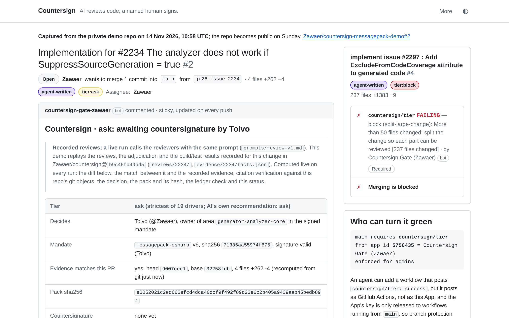
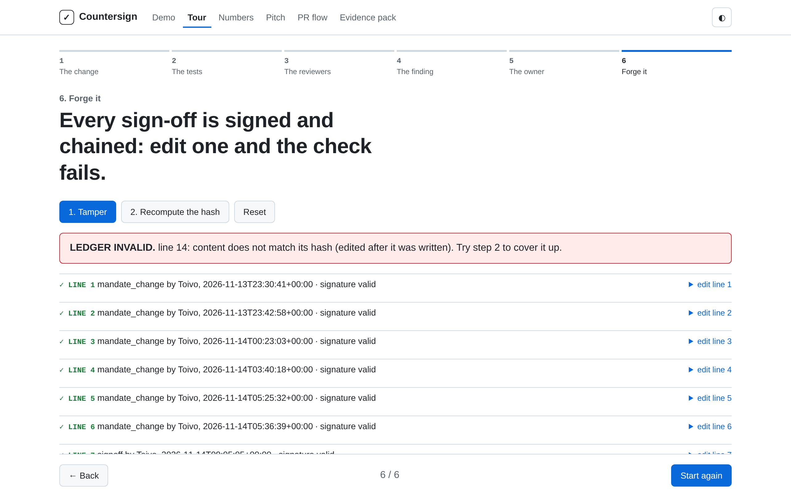
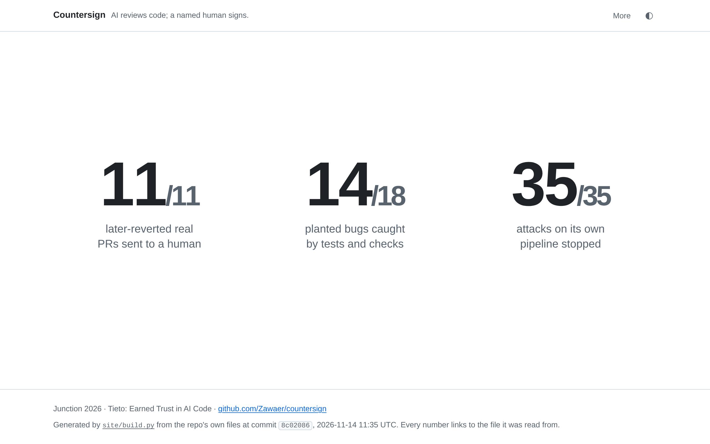

# Countersign

**Demo:** open [site/index.html](site/index.html) in a browser (it goes on GitHub Pages once the repo is public).

> **AI reviews agent-written code under a mandate. It clears what it can prove, refuses what it can't, and a named human countersigns the rest.**


**In numbers:** replayed on <!--n:history_prs-->109<!--/n--> real merged MessagePack-CSharp PRs (signed mandate v<!--n:history_mandate-->6<!--/n-->, upstream CI credited as passed), the AI would have cleared <!--n:history_cleared-->24<!--/n--> of them, and <!--n:history_escapes_cleared-->0<!--/n--> of the <!--n:history_escapes-->11<!--/n--> that later needed a revert or a follow-up fix. On Tieto's <!--n:agent_changes-->4<!--/n--> agent-written changes it sent <!--n:agent_routed-->4<!--/n--> to a named owner, each with its reason.

## See it

  

**On the PR:** the App's required status blocks merging until the owner signs. · **Forge the record:** edit one ledger line and the check says INVALID. · **The numbers:** three, each traceable to its rows.

**Three words used throughout:**
- **Mandate:** a signed, versioned file per repo that says, area by area, how far the AI may go alone and who owns each area.
- **Tier:** where a change goes. `silent` (the AI clears it, logged), `notify` (the AI clears it and tells the owner), `ask` (the owner must sign), `block` (fix or split first).
- **Escape:** a change that was merged and later needed a revert or a follow-up fix.

## How it works

0. **A failing check can't be argued away.** If a check the mandate requires fails, no reviewer vote or track record can clear the change. This is enforced in code.
1. **Facts first.** Build, tests, "do the new tests fail without the fix?", public API, analyzers, dependency changes and a scan for text planted to steer AI reviewers run before any model reads the diff.
2. **Three independent reviewers, unanimity.** Claude, Codex and Nemotron review separately. Every claim must cite a file line, test, check or requirement clause, and the engine re-checks it. A clause is proven only if every reviewer says "met" with verified evidence and its checks pass; anything else is refused, with the reason. Disputes go to Gemini, an adjudicator that can explain a dispute but never clear it.
3. **One reviewer can never clear.** Codex's second pass, given passing tests, said all <!--n:codex_v2_met-->11<!--/n--> of the <!--n:codex_v2_clauses-->11<!--/n--> clauses were met and found nothing (<!--n:codex_verified-->0<!--/n--> verified findings; it missed <!--n:codex_missed_majors-->6<!--/n--> verified majors the others found). It acted as a rubber stamp, which is why one reviewer's "all good" never outvotes another's verified objection: that stamp cleared nothing ([R1](docs/FAILURE_MODES.md)).
4. **Bugs a reviewer claims are re-run.** A reviewer's probe test becomes a repro check that the pipeline runs on the old and new code.
5. **The change explains itself.** An evidence pack: tier and why, requirement trace, findings, refusals, what was not checked, residual risk.
6. **A named owner countersigns.** An Ed25519 signature over the pack's hash, in a hash-chained ledger.
7. **Trust is earned per area.** An area moves from ask to notify after 20 agreeing spot-checks in a row, and to silent after 40. An escape, a disagreeing spot-check or a missed seeded-bug canary drops the area one stage. A new reviewer model or prompt version starts again at ask.

One page: [docs/CONCEPT_CARD.md](docs/CONCEPT_CARD.md). Rules a team could adopt: [docs/PRINCIPLES.md](docs/PRINCIPLES.md).

## Walkthrough: change 2234

Branch `ju26-issue-2234`, written by an agent: "The analyzer does not work if `SuppressSourceGeneration = true`". 4 files, +262 −4. Requirements `REQ-2234-F1`, `F2`, `N1`, `N2` in [requirements/2234.yaml](requirements/2234.yaml).

1. **Route.** `countersign route --all` prints one line per change. 2234 goes to `ask`, owner Toivo, because of a verified finding: the issue's regression is not on this base, and the change fixes a different crash.
2. **Open the pack.** [packs/2234/pack.md](packs/2234/pack.md) ([html](packs/2234/pack.html)). The first screen is the tier, the owner and why.
3. **Read the facts.** Build passes, the <!--n:t2234_new_tests-->8<!--/n--> new analyzer tests pass, the suite passes <!--n:t2234_suite_passed-->175<!--/n--> of <!--n:t2234_suite_total-->175<!--/n-->. But with the fix reverted, only <!--n:t2234_fail_without_fix-->4<!--/n--> of the <!--n:t2234_new_tests-->8<!--/n--> new tests fail, and <!--n:t2234_runtime_fail_without_fix-->0<!--/n--> of the <!--n:t2234_runtime_new-->4<!--/n--> new runtime tests fail. So clauses F1 and F2 are marked **held before**: met, but already true before this change, so the change did not achieve them. Mutation testing of the changed lines says the same thing a second way: the new tests kill <!--n:t2234_mutants_killed-->5<!--/n--> of <!--n:t2234_mutants-->8<!--/n--> mutants, all through the duplicate- and mixed-key tests; F1's and F2's own tests kill none, and <!--n:t2234_mutants_survived-->3<!--/n--> mutants survive every test ([facts.json](evidence/2234/facts.json), `tests.fail_without_fix`, `tests.mutation`).
4. **What the AI found.** Claude C1 (major): the reported regression comes from upstream commit `1a74a620`, which is not in this branch's base. Claude C2 (minor): `Key(null)` on a positional record still crashes the analyzer. The pipeline ran Claude's probe test itself: it fails on the new and old code and passes on a control branch, so the crash is reproduced, not just claimed.
5. **What the AI refused to decide.** N1 ("must not crash on invalid contracts"): Claude says not met, Codex and Nemotron say met, so it is not proven (the pack labels it NOT MET). Gemini, run in CI as the adjudicator, found Claude's objection supported (the unguarded cast at line 985, the reproduced crash) and sent the dispute to the owner. N2: Codex said met without verified evidence. Nemotron declined to judge two topics, the runtime library on other targets and security; both are sensitive, so they route to the owner. Four more refusals are out of scope for this change (among them whether it fixes #2234 for 3.1.x users, where nothing was built) and sit in one folded line.
6. **What was not checked.** Other .NET targets, the runtime library's tests, benchmarks, and the mandate's standing gaps. The risk score prints every point with its reason.
7. **Sign.** `countersign sign 2234 --as Toivo --decision request-changes --note "..."`. Only the named owner's key is accepted, and signing is refused if the pack changed. Toivo's private key is not in the repo.
8. **Try to tamper.** Copy `ledger/` to `/tmp/t`, edit one line, run `countersign verify-ledger --inputs /tmp/t`: `LEDGER INVALID: line 2: content does not match its hash`.

What the owner learns from the pack: the change fixes a different bug, half its new tests prove nothing, the reviewers disagree on the no-crash clause, and a `Key(null)` crash remains. What they decide: request changes or accept that risk, under their name.

The pack does not save reading time here. On small changes (2234, 2283) it takes longer to read than the diff (<!--n:pack_min_2234-->47<!--/n--> vs <!--n:read_min_2234-->26<!--/n--> minutes on 2234, simulated reading model). The payoff is accountability and catching what a diff read misses: a green, fully tested change that fixes the wrong bug. Time is saved only on large changes (2129, 2297) and on changes the AI clears.

## All seven real changes

Four were written by an agent (Tieto's branches). Three are small merged upstream PRs we added as controls, to show that a low-risk change can go through.

| Change | Size | Tier | The deciding reason |
|---|---|---|---|
| [2283](packs/2283/pack.md) | 4 files, +225 −3 | `ask` | The fix silences a warning (MsgPack003) that the old code reports. Claude found it; the pipeline reproduced it. |
| [2234](packs/2234/pack.md) | 4 files, +262 −4 | `ask` | It fixes a different crash than the issue reports. |
| [2129](packs/2129/pack.md) | 28 files, +1034 −9 | `block` | New public API with no API tracking, a new analyzer warning and a project missing from the solution: two failed checks in a critical area push the risk score into the block band. |
| [2297](packs/2297/pack.md) | 237 files (228 generated), +1383 −9 | `block` | More than 50 files: split it. A reviewer also found a wrong `#if` that leaves .NET Framework and netstandard users without the attribute. |
| [up-2022](packs/up-2022/pack.md) | 2 files, +29 −0 | `ask` | All clauses proven, but Nemotron refused to judge runtime deserialization security, a topic on the mandate's list of terms that always ask. |
| [up-1934](packs/up-1934/pack.md) | 6 test files, +26 −22 | `ask` | All clauses proven, but Nemotron refused to judge the build on other target frameworks, and `build` is a mandated check. |
| [up-1967](packs/up-1967/pack.md) | 1 doc file, +1 −1 | `notify` | A one-line README anchor fix. All three reviewers agree and the anchor check passes, so the AI clears it and tells Rene. |
| [demo-docs1](packs/demo-docs1/pack.md) | 1 doc file, +1 −1 | `notify` | An agent-written README link fix in the demo repo. Cleared by the AI and **merged through the gate in 40 s** ([PR #11](https://github.com/Zawaer/countersign-messagepack-demo/pull/11)); Rene was told, not asked. |

<!--n:real_routed-->6<!--/n--> of <!--n:real_changes-->8<!--/n--> go to a human. The AI clears only the two docs fixes.

## Measurement

- **History (real).** <!--n:history_prs-->109<!--/n--> merged upstream PRs, routed from their diffs by the signed mandate (v<!--n:history_mandate-->6<!--/n-->, the same result as under v2 and v4; upstream CI credited as passed). <!--n:history_escapes-->11<!--/n--> were later reverted or needed a follow-up fix. The AI would have cleared <!--n:history_cleared-->24<!--/n--> PRs, and **<!--n:history_escapes_cleared-->0<!--/n--> of the <!--n:history_escapes-->11<!--/n--> escapes** ([measurement/history/results.md](measurement/history/results.md)). <!--n:history_escapes_cleared-->0<!--/n--> of <!--n:history_cleared-->24<!--/n--> is a small sample: it still allows an escape rate of up to about <!--n:history_cleared_upper_pct-->12<!--/n-->% among the cleared.
- **Seeded changes (real).** We seeded <!--n:seeded_total-->18<!--/n--> changes: <!--n:seeded_bugs-->14<!--/n--> one-line bugs, <!--n:seeded_injections-->2<!--/n--> prompt injections, 1 supply-chain attack and 1 quiet security downgrade. Checks alone catch <!--n:seeded_caught_by_checks-->14<!--/n--> of the <!--n:seeded_total-->18<!--/n--> (<!--n:seeded_bugs_caught_by_checks-->11<!--/n--> of <!--n:seeded_bugs-->14<!--/n--> bugs; both injections, caught by the planted-text scan; the supply-chain attack, caught by the dependency diff). The <!--n:seeded_reviewed-->17<!--/n--> with reviews all go to a human (the supply-chain attack has no reviews). <!--n:seeded_survivors-->4<!--/n--> got past every check (three removed guards and the security downgrade): a reviewer flagged the planted line in <!--n:seeded_survivors_flagged_new-->3<!--/n--> of <!--n:seeded_survivors-->4<!--/n--> with a finding the unmutated original did not already have at that line (<!--n:seeded_survivors_flagged-->4<!--/n--> of <!--n:seeded_survivors-->4<!--/n--> counting any finding at that line); Nemotron alone in <!--n:nemotron_survivors_flagged-->3<!--/n--> of <!--n:nemotron_survivors_reviewed-->4<!--/n-->. It missed the removed `ContainsSyntaxTree` guard on 2283-mut1, the guard all three reviewers accepted (REQ-2283-F3 met) on the original.
- **Owner sign-offs (real).** Toivo countersigned <!--n:signoffs-->4<!--/n--> changes in the ledger and rated every verified AI finding: he accepted Claude's in <!--n:claude_accepted-->9<!--/n--> of <!--n:claude_rated-->13<!--/n--> and Nemotron's in <!--n:nemotron_accepted-->8<!--/n--> of <!--n:nemotron_rated-->10<!--/n-->, and overrode the routing on <!--n:owner_overrode-->0<!--/n--> of <!--n:owner_overrode_of-->4<!--/n-->.

**More measurements** in [docs/MEASUREMENT.md](docs/MEASUREMENT.md): simulated review time and trust over time, the same-issue benchmark ([docs/BENCHMARK.md](docs/BENCHMARK.md)), scaling cost ([docs/SCALING.md](docs/SCALING.md)) and the red team ([docs/security/REDTEAM.md](docs/security/REDTEAM.md)).

## Limits

- It can't judge **intent**: whether this is the change the product needs.
- It is only as good as the **requirement text**.
- **Breadth equals the checks.** We have checks for a C# library on net8.0/Linux. Frontend, performance and other targets fall back to humans and are listed as not checked.
- **Reviewers share blind spots.** On the original 2283, all three reviewers said REQ-2283-F3 was met, though no test exercises the guard it depends on.
- **The merge gate is owned by a dedicated App.** Our triage found that any GitHub Actions workflow could post the required status (T1). Closed Sat 11:30: the status is posted by the "Countersign Gate" GitHub App, whose key only `main`'s workflows can read, and branch protection accepts it from that App only ([docs/security/TRIAGE.md](docs/security/TRIAGE.md)).
- Gemini adjudicates only disputes, and only <!--n:gemini_adjudicated-->6<!--/n--> changes had one (<!--n:gemini_real_changes-->2234 and 2283<!--/n-->, plus <!--n:gemini_variants-->4<!--/n--> generated benchmark variants). Key rotation and revocation are out of scope.

## Run it

One command, from a fresh clone. Needs Python 3.11+ and [uv](https://docs.astral.sh/uv/); offline apart from `uv sync`, no API keys, no MessagePack clone, no .NET:

```bash
scripts/demo.sh          # or: make demo   (add --step to pause after each step)
```

It walks the 2234 story above in 9 steps, from the committed evidence, reviews and packs: route the seven changes, the sign-off card, a verified finding with its cited line, the clause the reviewers disagree on, the clauses that held before, a signature with a throwaway key in a temp workspace, a tampered ledger caught by line, a seeded bug no test catches and a prompt injection, and the three headline numbers. It takes a few seconds; the full output is in [docs/DEMO_OUTPUT.md](docs/DEMO_OUTPUT.md). Then open [site/index.html](site/index.html).

To re-derive the packs from the evidence (code quotes are re-checked against the MessagePack-CSharp git history, so this needs the clone):

```bash
uv sync --extra dev      # or: python3 -m venv .venv && . .venv/bin/activate && pip install -e '.[dev]'
git clone https://github.com/te-industry-tech-office/junction26-messagepack-csharp /tmp/mp
uv run countersign route --all --repo /tmp/mp   # tier per change, seeded changes included
uv run countersign review 2234 --repo /tmp/mp   # rebuild packs/2234
uv run countersign verify-ledger                # check every signature
uv run countersign trust                        # trust stage per area
make test                                       # pytest
```

## What is real, recorded and simulated

- **Real:** branches, diffs, every build and test result in `evidence/` (with logs), repro checks, seeded bugs, verification, routing, packs, signatures, the ledger, the history replay.
- **Recorded:** Claude and Codex reviews, run in agent sessions and saved verbatim in `reviews/`. Nemotron reviews and Gemini's adjudications were run live by CI jobs, with the request and response saved under `reviews/<change>/raw/`.
- **Simulated, and labelled:** spot-checks, escapes and canaries over time, and every review-time number.
- **Placeholder:** the requirement sets. We derived them from each upstream issue and marked them `official: false`.

## Tech tracks

- **Codex (OpenAI):** one of the three reviewers, on all seven changes. Its second pass, given passing tests, said all <!--n:codex_v2_met-->11<!--/n--> of the <!--n:codex_v2_clauses-->11<!--/n--> clauses on the agent changes were met and found nothing (<!--n:codex_verified-->0<!--/n--> verified findings, <!--n:codex_missed_majors-->6<!--/n--> verified majors missed). It acted as a rubber stamp, which is why one reviewer can never clear a change (R1) ([docs/CODEX_LOG.md](docs/CODEX_LOG.md)). Codex also did a security review of our own pipeline; the triage confirmed 8 issues (4 Codex found, 4 it missed), fixed 7 of them, including the merge-gate hole T1 (closed by the Countersign Gate GitHub App), and described the fix for the last, a low-severity one ([docs/security/TRIAGE.md](docs/security/TRIAGE.md)).
- **Gemini (Google):** the adjudicator. It reads only disputed items with both sides' evidence; the engine never lets it clear anything (`decide.apply_adjudication`). Run in CI on the disputes in <!--n:gemini_real_changes-->2234 and 2283<!--/n--> and <!--n:gemini_variants-->4<!--/n--> benchmark variants (<!--n:gemini_tokens-->31,671<!--/n--> tokens, $<!--n:gemini_usd-->0.08<!--/n-->; `reviews/<change>/adjudication.gemini.json`); its rulings are in the packs.
- **Nemotron (NVIDIA, open weights):** one of the three reviewers, run live in CI on all seven real changes and on the <!--n:seeded_reviewed-->17<!--/n--> seeded changes that have reviews (all but the supply-chain attack). Of the <!--n:nemotron_survivors_reviewed-->4<!--/n--> seeded changes that got past every check, it flagged the planted line in <!--n:nemotron_survivors_flagged-->3<!--/n-->. It is the only reviewer marked self-hostable, so it is the one a repo marked confidential may use.
- **CRACI:** the pipeline and the reviewer jobs run on CRACI runners under a deny-by-default network policy. The facts job also writes `deps.delta` (a CycloneDX SBOM diff of the NuGet graph, base vs head; passes on all four changes, fails on a seeded attack on 2283) and `build.egress` (copies the build's network policy into the evidence; passes on all four). A `craci` job adds CRACI's own record of each build, `craci.sbom` and `craci.network` (pass on all four: 0 proxy violations). See [docs/CI.md](docs/CI.md).

More: [docs/ARCHITECTURE.md](docs/ARCHITECTURE.md), [docs/PR_FLOW.md](docs/PR_FLOW.md) (GitHub flow: merge blocked until a valid countersignature), [docs/DECISIONS.md](docs/DECISIONS.md), [docs/FAILURE_MODES.md](docs/FAILURE_MODES.md), [docs/LESSONS.md](docs/LESSONS.md), [docs/COSTS.md](docs/COSTS.md).

Team: Toivo and Rene.
